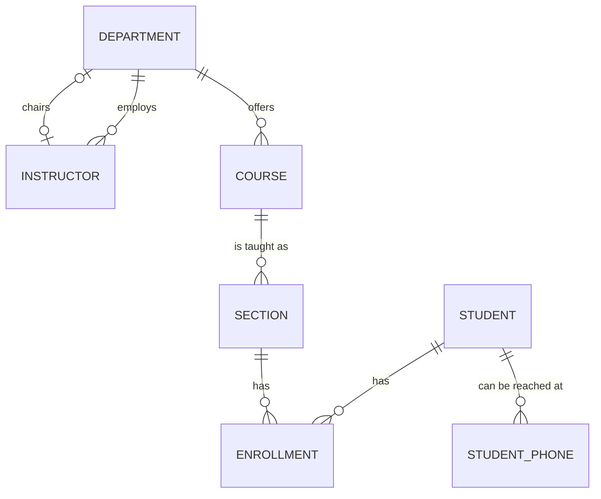

# 🔗 The Entity-Relationship Model

## What the ER Model Is For

An **entity-relationship (ER) model** describes the things of interest in a field and how they are related. It was developed for database design and published by Peter Chen in 1976, in the paper "The Entity-Relationship Model: Toward a Unified View of Data", although variants of the idea existed before ([Wikipedia: Entity-relationship model](https://en.wikipedia.org/wiki/Entity%E2%80%93relationship_model)). A model of this kind is a drawing of what a business needs to remember, and it can be turned into a database, typically a relational one (the same article). All code was run on CPython 3.9 on a Mac (macOS, Apple silicon) with SQLite 3.54; the results are deterministic.

## 🧱 Entities, Attributes, and Relationships

- An **entity** is a distinguishable thing that data is stored about: a physical object, an event, or a concept. Strictly, an **entity type** is the category (*student*) and an entity one instance of it (a particular student), although people often say "entity" for both.
- A **relationship** says how entities are connected: a department *offers* a course. Entities are often nouns and relationships verbs.
- **Attributes** describe entities, and relationships can have attributes too, such as the grade of an enrollment (all from the [same article](https://en.wikipedia.org/wiki/Entity%E2%80%93relationship_model)). Some attributes need care: a **composite** attribute is made of parts (a name made of a first and a last name), a **multivalued** attribute can have several values for one entity (phone numbers), and a **derived** attribute is computed from others (age from the date of birth) ([GeeksforGeeks: Introduction of ER Model](https://www.geeksforgeeks.org/dbms/introduction-of-er-model/)).
- Every entity type normally has a **key**: attributes that identify each entity uniquely. A **weak entity** cannot be identified by its own attributes; it is identified together with the entity that owns it, as section 2 of course CS101 is identified by the course and the number 2 ([GeeksforGeeks: Weak Entity Set](https://www.geeksforgeeks.org/dbms/weak-entity-set-in-er-diagrams/)).

## 🔢 Cardinality and Participation

**Cardinality** says how many entities on one side can be connected to one entity on the other. The common cases are:

| Cardinality | Meaning | Example |
|-------------|---------|---------|
| **One-to-one (1:1)** | each entity on either side is connected to at most one on the other | a department has at most one chair, and a person chairs at most one department |
| **One-to-many (1:N)** | one entity on the first side to many on the second; each of the second to at most one of the first | a department offers many courses; a course belongs to one department |
| **Many-to-many (M:N)** | many on each side | students take many sections, and sections have many students |

**Participation** says whether every entity must take part in a relationship. Participation is **total** if every entity of a type must be connected (every course belongs to a department) and **partial** if some need not be (not every instructor chairs a department) ([GeeksforGeeks: Introduction of ER Model](https://www.geeksforgeeks.org/dbms/introduction-of-er-model/)). A weak entity's participation in the relationship that identifies it is always total (the same page).

## ✏️ Notation: Chen and Crow's Foot

In Chen's notation, entity types are rectangles, relationships are diamonds, and attributes are ovals. A widely used alternative is **crow's foot** notation, which dates from an article by Gordon Everest in 1976: entity types are boxes, and the shapes at the ends of the connecting lines show the cardinality. In crow's foot notation, relationships cannot have attributes, so a relationship that needs them is turned into an entity of its own ([Wikipedia: Entity-relationship model](https://en.wikipedia.org/wiki/Entity%E2%80%93relationship_model)). The diagram below is drawn with the crow's foot markers of the [Mermaid](https://mermaid.js.org/syntax/entityRelationshipDiagram.html) diagram language, in which each end of a line shows a minimum and a maximum: `||` means exactly one, `o|` zero or one, `o{` zero or more, and `|{` one or more. *Enrollment* is shown as an entity because it carries the grade:



Read the first line as: each instructor belongs to exactly one department, and a department employs zero or more instructors. The second says that a department has at most one chair, and an instructor chairs at most one department. *Section* is a weak entity: it exists only for a course.

## 🔁 From Diagram to Tables

An ER diagram turns into a relational schema by a few rules. In a simple relational implementation, each row of a table represents one entity, each column an attribute, and a relationship is stored as a **foreign key**: the primary key of one entity kept in the table of another ([Wikipedia: Entity-relationship model](https://en.wikipedia.org/wiki/Entity%E2%80%93relationship_model)). A many-to-many relationship needs a table of its own, an **associative table** ([Wikipedia: Associative entity](https://en.wikipedia.org/wiki/Associative_entity)):

| In the diagram | In the database |
|----------------|-----------------|
| Entity type | a table; its key becomes the primary key |
| Composite attribute | one column per part |
| Multivalued attribute | a separate table, keyed by the owner and the value |
| Derived attribute | computed when read (for example in a view), not stored |
| 1:N relationship | a foreign key on the "many" side, `NOT NULL` if participation is total |
| 1:1 relationship | a foreign key on one side with a `UNIQUE` constraint |
| M:N relationship | an associative table whose primary key is the pair of foreign keys; relationship attributes go there |
| Weak entity | a table whose primary key includes the owner's key, with a foreign key that deletes it with its owner |

```python
import sqlite3

SCHEMA = """
    CREATE TABLE department (id INTEGER PRIMARY KEY, name TEXT NOT NULL UNIQUE,
                             chair_id INTEGER UNIQUE REFERENCES instructor(id));       -- 1:1, partial on both sides
    CREATE TABLE instructor (id INTEGER PRIMARY KEY, first_name TEXT NOT NULL, last_name TEXT NOT NULL,  -- composite name
                             department_id INTEGER NOT NULL REFERENCES department(id));              -- 1:N, total
    CREATE TABLE course (code TEXT PRIMARY KEY, title TEXT NOT NULL,
                         department_id INTEGER NOT NULL REFERENCES department(id));
    CREATE TABLE section (course_code TEXT NOT NULL REFERENCES course(code) ON DELETE CASCADE,
                          section_no INTEGER NOT NULL, term TEXT NOT NULL,
                          PRIMARY KEY (course_code, section_no));                                    -- weak entity
    CREATE TABLE student (id INTEGER PRIMARY KEY, name TEXT NOT NULL, born_on TEXT NOT NULL);
    CREATE TABLE student_phone (student_id INTEGER NOT NULL REFERENCES student(id), phone TEXT NOT NULL,
                                PRIMARY KEY (student_id, phone));                                    -- multivalued
    CREATE TABLE enrollment (student_id INTEGER NOT NULL REFERENCES student(id),
                             course_code TEXT NOT NULL, section_no INTEGER NOT NULL, grade TEXT,     -- M:N + attribute
                             PRIMARY KEY (student_id, course_code, section_no),
                             FOREIGN KEY (course_code, section_no) REFERENCES section(course_code, section_no));
    CREATE VIEW student_age AS                                                                       -- derived attribute
        SELECT id, name, CAST((julianday('2026-01-01') - julianday(born_on)) / 365.2425 AS INTEGER) AS age_on_2026_01_01
        FROM student;
"""
db = sqlite3.connect(":memory:", isolation_level=None)
db.execute("PRAGMA foreign_keys = ON")
db.executescript(SCHEMA)
db.executescript("""
    INSERT INTO department VALUES (1, 'Computer Science', NULL), (2, 'Mathematics', NULL);
    INSERT INTO instructor VALUES (10, 'Grace', 'Hopper', 1), (11, 'Emmy', 'Noether', 2);
    UPDATE department SET chair_id = 10 WHERE id = 1;
    INSERT INTO course VALUES ('CS101', 'Programming', 1), ('CS102', 'Databases', 1);
    INSERT INTO section VALUES ('CS101', 1, 'spring'), ('CS101', 2, 'spring'), ('CS102', 1, 'autumn');
    INSERT INTO student VALUES (100, 'Ada', '2005-12-10');
    INSERT INTO student_phone VALUES (100, '555-0100'), (100, '555-0199');
    INSERT INTO enrollment VALUES (100, 'CS101', 1, NULL);
""")
print("derived age:", db.execute("SELECT * FROM student_age").fetchall())

def attempt(description, statement):
    try:
        db.execute(statement)
        print(f"{description:<52} accepted")
    except sqlite3.IntegrityError as error:
        print(f"{description:<52} rejected ({str(error).split(':')[0]})")

attempt("a course with no department (total participation)", "INSERT INTO course (code, title) VALUES ('X1', 'Mystery')")
attempt("the same person chairing two departments (1:1)", "UPDATE department SET chair_id = 10 WHERE id = 2")
attempt("a second chair for a department replaces the first", "UPDATE department SET chair_id = 11 WHERE id = 1")
attempt("a section of a missing course (weak entity)", "INSERT INTO section VALUES ('CS999', 1, 'spring')")
attempt("a second section 1 of CS101 (partial key)", "INSERT INTO section VALUES ('CS101', 1, 'autumn')")
attempt("enrolling in the same section twice (M:N)", "INSERT INTO enrollment VALUES (100, 'CS101', 1, 'A')")
attempt("enrolling in a section that does not exist", "INSERT INTO enrollment VALUES (100, 'CS101', 9, NULL)")
attempt("the same phone number twice for a student", "INSERT INTO student_phone VALUES (100, '555-0100')")
attempt("deleting a section that has students", "DELETE FROM section WHERE course_code = 'CS101' AND section_no = 1")
db.execute("DELETE FROM course WHERE code = 'CS102'")
print("after deleting CS102, its sections left:", db.execute("SELECT count(*) FROM section WHERE course_code = 'CS102'").fetchone()[0])
db.close()
```

```text
derived age: [(100, 'Ada', 20)]
a course with no department (total participation)    rejected (NOT NULL constraint failed)
the same person chairing two departments (1:1)       rejected (UNIQUE constraint failed)
a second chair for a department replaces the first   accepted
a section of a missing course (weak entity)          rejected (FOREIGN KEY constraint failed)
a second section 1 of CS101 (partial key)            rejected (UNIQUE constraint failed)
enrolling in the same section twice (M:N)            rejected (UNIQUE constraint failed)
enrolling in a section that does not exist           rejected (FOREIGN KEY constraint failed)
the same phone number twice for a student            rejected (UNIQUE constraint failed)
deleting a section that has students                 rejected (FOREIGN KEY constraint failed)
after deleting CS102, its sections left: 0
```

Each rule of the diagram is now enforced by the database, whatever program writes the data. Note the third line: replacing a department's chair is a legal change, because a department still has at most one chair afterwards; the one-to-one rule only stops one person chairing two departments. Deleting a course deletes its sections with it (`ON DELETE CASCADE`), as befits a weak entity, but a section that has students cannot be deleted until their enrollments are dealt with.

## 🧪 Do the Constraints Mean What We Think?

A mapping rule is a claim: that the constraints accept exactly the sets of relationship pairs that the cardinality allows. For three entities on each side, there are only nine possible pairs, so every one of the 512 possible sets can be tried. The expected counts can be computed independently: any set is a valid many-to-many relationship (2⁹ = 512 sets); a one-to-many relationship gives each of the 3 entities on the "many" side one of 3 partners or none (4³ = 64 sets); and a one-to-one relationship is a partial matching:

```python
import itertools
import math

PAIRS = [(a, b) for a in range(3) for b in range(3)]
MAPPINGS = {
    "many-to-many": "PRIMARY KEY (a, b)",
    "one-to-many": "PRIMARY KEY (a, b), UNIQUE (b)",              # each b has at most one a
    "one-to-one": "PRIMARY KEY (a, b), UNIQUE (a), UNIQUE (b)",
}
EXPECTED = {
    "many-to-many": 2 ** len(PAIRS),
    "one-to-many": (3 + 1) ** 3,
    "one-to-one": sum(math.comb(3, k) ** 2 * math.factorial(k) for k in range(4)),
}

def accepts(constraints, pairs):
    """Can an associative table with these constraints store all of these pairs?"""
    connection = sqlite3.connect(":memory:", isolation_level=None)
    connection.execute(f"CREATE TABLE link (a INTEGER NOT NULL, b INTEGER NOT NULL, {constraints})")
    try:
        connection.executemany("INSERT INTO link VALUES (?, ?)", pairs)
        return True
    except sqlite3.IntegrityError:
        return False
    finally:
        connection.close()

def respects(kind, pairs):
    """The cardinality rule itself, written without a database."""
    if kind in ("one-to-many", "one-to-one") and len({b for _, b in pairs}) < len(pairs):
        return False
    return kind != "one-to-one" or len({a for a, _ in pairs}) == len(pairs)

every_set = [list(chosen) for size in range(len(PAIRS) + 1) for chosen in itertools.combinations(PAIRS, size)]
for kind, constraints in MAPPINGS.items():
    accepted = [pairs for pairs in every_set if accepts(constraints, pairs)]
    agrees = all(accepts(constraints, pairs) == respects(kind, pairs) for pairs in every_set)
    print(f"{kind:<13} {len(accepted):>3} of {len(every_set)} sets accepted (expected {EXPECTED[kind]:>3}); "
          f"matches the rule on every set: {agrees}")
```

```text
many-to-many  512 of 512 sets accepted (expected 512); matches the rule on every set: True
one-to-many    64 of 512 sets accepted (expected  64); matches the rule on every set: True
one-to-one     34 of 512 sets accepted (expected  34); matches the rule on every set: True
```

The constraints accept exactly what each cardinality allows. What they **cannot** express is total participation on a side of a many-to-many relationship ("every student must take at least one section"): a junction table can only restrict the pairs it holds, not force a pair to exist. Such rules need application logic, triggers, or other mechanisms.

## Common Misconceptions

- **"An ER diagram is a drawing of the tables."** It is a model of the things and relationships; the tables are one way of implementing it, and the mapping can add tables (for many-to-many relationships and multivalued attributes).
- **"One-to-one means one foreign key is enough."** Without a `UNIQUE` constraint, a foreign key allows many rows to point at the same one, which is one-to-many.
- **"Many-to-many relationships can be stored with a list in a column."** A list in one column is hard to search and to constrain; an associative table stores one pair per row, which the database can check.
- **"Weak entity means unimportant."** It means that it is identified through its owner, and cannot exist without it.

## ➡️ Next

This completes the Introduction to DBMS module: why databases exist, how data is modeled, and how an entity-relationship diagram becomes a schema. The next module of this section, [The Relational Model](../the-relational-model/README.md), studies the structures this schema was built from: relations, keys, and the operations that combine them.
